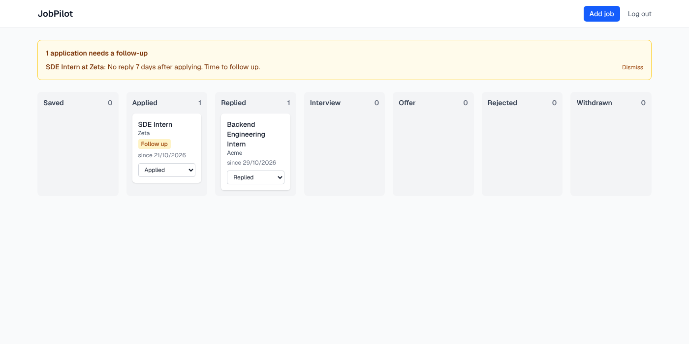

# JobPilot

Job application tracker with an AI agent that scores job fit and drafts tailored
resumes for your approval. Built over four weeks; this is Week 1 (full-stack foundation).

## Stack

- `apps/api`: Go 1.26, chi, pgx, goose migrations, JWT (HS256) + bcrypt
- `apps/web`: Next.js 16 (App Router, TypeScript, Tailwind)
- PostgreSQL 16

Schema design: [docs/schema.md](docs/schema.md).



## How auth works

The Go API issues a 24-hour HS256 JWT on sign-up and login. The Next.js app
never hands that token to browser JavaScript: server actions call the API and
store the token in an `httpOnly`, `SameSite=Lax` cookie (`Secure` in
production), then forward it as a bearer token on every server-side API call.
An expired or missing token sends you back to `/login`.

## Run locally

Needs Go 1.26+, Node 22+ and Docker (or any Postgres 16 on `localhost:5432`).

```bash
npm run db:up                         # Postgres (creates jobpilot and jobpilot_test)
cd apps/api
cp .env.example .env                  # then set JWT_SECRET: openssl rand -hex 32
make run                              # http://localhost:4000, migrates on start
make test                             # unit + API tests against jobpilot_test

cd ../.. && npm install && npm run dev:web   # http://localhost:3000
```

The web app reads `API_URL` (default `http://localhost:4000`). With both apps
running, `node apps/web/e2e/smoke.cjs` drives the main flows in a real browser
(sign up, add, move on the board, edit, delete, log out, log in).

## API

All bodies are JSON. Everything except `/health` and `/auth/*` needs
`Authorization: Bearer <token>`. Validation errors are `422` with
`{"error": "validation failed", "fields": {"title": "is required"}}`.

| Method | Path | What it does |
|---|---|---|
| GET | `/health` | API and database status |
| POST | `/auth/signup` | `{email, password, name?}` → `201 {token, user}` |
| POST | `/auth/login` | `{email, password}` → `{token, user}` |
| GET | `/me` | Current user |
| GET | `/jobs?status=applied` | Your jobs, newest first, optional status filter |
| POST | `/jobs` | Add a job; its application starts as `saved` |
| GET | `/jobs/{id}` | One job with its application |
| PUT | `/jobs/{id}` | Replace the job's fields and notes |
| DELETE | `/jobs/{id}` | Delete the job, its application and history |
| PUT | `/jobs/{id}/status` | `{status, note?}`; `409` if unchanged |
| GET | `/jobs/{id}/history` | Status changes, oldest first |
| GET | `/reminders` | Open follow-up reminders (applied 7+ days, no change) |
| POST | `/reminders/{id}/dismiss` | Dismiss a reminder |

Job fields: `company`, `title`, `description` (required), `location`, `url`
(http/https), `platform`, `salaryMin`, `salaryMax`, `currency` (3 letters), `notes`.
